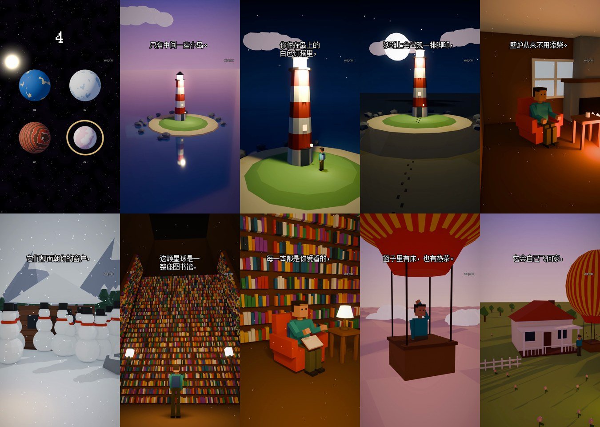

# 选星球互动短视频 · Pick a Planet

[中文](#中文) · [English](#english)

https://github.com/user-attachments/assets/731b36fc-19ea-42f8-993d-11081d481e3f

参考视频：用这个 Skill 从零做出来的一条，1 分 45 秒，4 颗星球、23 个镜头。场景是 Blender 代码搭的低多边形 3D，没用 AI 视频模型，也没用任何图片、视频素材。高清文件：[`assets/demo.mp4`](assets/demo.mp4)



---

## 中文

「选一颗星球，你要在这里活一年。」开头 4 颗编号星球同框，倒数 5 秒逼你先选；然后一颗一颗讲，每颗都美得想住，讲完补一句「但是」和一条保命规矩。前三颗有坑，最安全的那颗放最后。

这个玩法在 IG 上一个开号 3 周的账号拿了 3400 万播放，最火一条 1987 万。这个仓库是一个 **Claude Skill**：装进 Claude Code 后说「做一条选星球视频」，它帮你写四颗原创星球的台词，再用代码把整条视频做出来。

- **脚本有模板**：每颗星球固定五句，一整片什么、两个好处、住在哪、一个「但是」、一条保命规矩
- **画面全是代码**：Blender 用 Python 搭场景（灯塔、雪原、图书馆、热气球……30 多种道具、7 种时间光照），Eevee 渲染，一张图不到 1 秒
- **会动**：水退下去、人走过去这种镜头按 15 帧 / 秒渲染；其余镜头慢慢推近
- **像素字幕 + 配音 + 配乐**：字幕是点阵字放大的复古像素风；配音默认 edge-tts（可以换成你自己的克隆声音）；配乐、倒数声、转场声都是 numpy 合成的
- 一条两分钟 1080x1920 的视频，电脑跑十几分钟

### 装

把这个仓库的链接丢给 Claude Code（或 Codex），说「帮我装成 Skill」。

需要：Blender 4.2+（免费，blender.org）、Python 3.10+、`pip install numpy opencv-python pillow edge-tts`、命令行能用的 `ffmpeg`。像素字幕用 Windows 自带的宋体。

### 用

在 Claude Code 里说「做一条选星球视频，四颗星球你来想」。或者自己跑：

```
python scripts/make.py examples/demo-zh --preview   # 半分辨率预览，一两分钟
python scripts/make.py examples/demo-zh             # 1080x1920 正片
```

写法见 [`SKILL.md`](SKILL.md)，场景怎么写见 [`docs/scene-vocab.md`](docs/scene-vocab.md)。

### 许可

代码 MIT。玩法参考了 IG 上的选星球互动号（比如 miniworldsim），代码、星球和台词都是从零写的，不含对方任何素材。

---

## English

"Choose a planet. You must survive one year here." Four numbered planets, a 5-second countdown so viewers commit to a pick, then each planet gets the same five lines: what it is, two perks, where you live, a "but…", and one survival rule. Three planets hide a catch; the safe one comes last.

This is a **Claude Skill**. Install it in Claude Code and say "make a pick-a-planet video": it writes four original planets and builds the whole video from code — low-poly 3D scenes assembled in Blender with Python and rendered with Eevee, pixel captions, narration (edge-tts placeholder or your own cloned voice) and a synthesized music bed. No AI video models, no stock assets.

Requires Blender 4.2+, Python 3.10+, `pip install numpy opencv-python pillow edge-tts`, and `ffmpeg`.

```
python scripts/make.py examples/demo-zh --preview
python scripts/make.py examples/demo-zh
```

MIT licensed. Format inspired by planet-choice accounts on Instagram (e.g. miniworldsim); all code, planets and lines are original.
